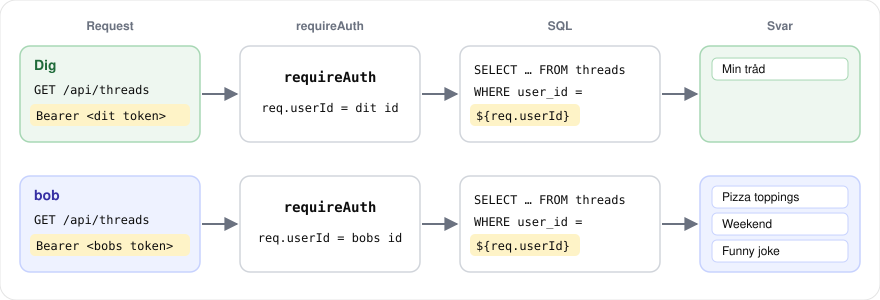
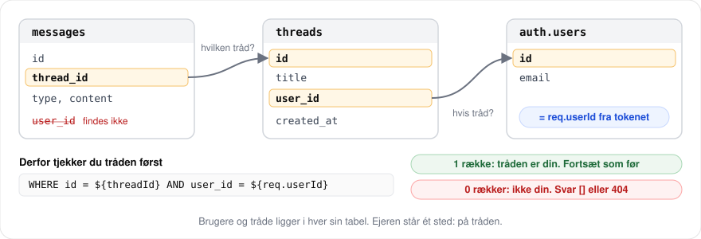

# Chatbot step 17: Kun dine egne tråde

## Kort fortalt

Efter step 16 ved backenden, hvem der spørger. Id'et står i `req.userId`. Men SQL'en bruger det ikke. Alle, der er logget ind, ser alle tråde, og de kan rette og slette andres tråde, hvis de kender id'et. Nye tråde får stadig `TEST_USER_ID` som ejer.

I denne opgave laver du [step 17](https://github.com/bewildergeist/chatbot-react-postgres/pull/17) i chatbot-tutorialen, bare på dansk og i mindre trin. Du bruger `req.userId` i hver SQL-query, så hver bruger kun kan se og ændre sine egne tråde.

Tutorialen laver step 18 før step 17. Du laver dem i rækkefølge, så step 17 kommer først. Bagefter laver du [Chatbot step 18](chatbot-step-18-send-til-login.md).

Delopgave 1 og 2 i tutorialen tilføjer kolonnen `user_id` til `threads`. Den har du allerede i kursets database. Du kigger på den i øvelse 1 og springer resten over.

Løsningen ligger i commits i step 17. Sidst i opgaven står, hvilken øvelse der svarer til hvilket commit.

<details>
<summary>💡 Sidder du fast undervejs? Sådan bruger du hjælpen i denne øvelse</summary>

Prøv selv først. Går det ikke:

1. Åbn **Hint**-toggle'n under øvelsen. Den peger dig i den rigtige retning uden at give dig koden.
2. Åbn **Løsningsforslag**-toggle'n, når hintet ikke er nok, eller når du vil sammenligne med din egen kode.

Spring aldrig en test over, heller ikke når den virker oplagt.

</details>

## Det bygger du



Det sker i koden:

```text
Før:        SELECT ... FROM threads                              -> alle tråde
Nu:         SELECT ... FROM threads WHERE user_id = ${req.userId} -> kun dine
Én tråd:    WHERE id = ${threadId} AND user_id = ${req.userId}   -> 404, hvis den ikke er din
Ny tråd:    INSERT ... VALUES (${trimmedTitle}, ${req.userId})
```

## Kom i gang

Start backend og frontend, som du plejer. Log ind på `/login` med din egen bruger.

Er du ikke færdig med step 16, så hent startpunktet i roden af chatbot-repoet, og commit det, før du ændrer noget:

```bash
npx degit --force bewildergeist/chatbot-react-postgres#pr-17-start
```

Tutorialen skriver `pr-17-start-after-18`, fordi den laver step 18 først. Brug `pr-17-start`.

Startpunktet opretter tråde uden `user_id`. Sæt `TEST_USER_ID` ind i `backend/server.js` igen. Kodestykket står i [React Supabase Auth: Login før chatbotten](react-supabase-auth.md#fra-øvelserne-til-step-14). Du fjerner den igen i øvelse 2.

Startpunktet har step 16 med. Har du ikke lavet det, så kør `npm install` i `backend`, og skriv `SUPABASE_URL` og `SUPABASE_ANON_KEY` i `backend/.env`. Ellers starter backenden ikke.

Startpunktets `apiFetch` ser lidt anderledes ud end løsningsforslagene her. Den virker på samme måde.

---

## Øvelse 1: Hvem ejer hvad?

Her skal du ikke skrive kode. Du finder ud af, hvem der ejer trådene, og hvad du kan gøre ved andres tråde.

> **Authentication og authorization:** to ord, der ligner hinanden. Authentication er "hvem er du?". Det tjekker `requireAuth` fra step 16. Svaret nej giver `401`. Authorization er "hvad må du?". Det er dette step. Du er logget ind, men det betyder ikke, at du må se bobs tråde.

1. Åbn SQL Editor i Supabase. Kør denne query. Du har skrevet en lignende med MAGL:

   ```sql
   SELECT u.email, COUNT(t.id) AS threads
   FROM auth.users u
   LEFT JOIN threads t ON t.user_id = u.id
   GROUP BY u.email;
   ```

   Hvor mange tråde har din egen bruger? Hvor mange har alice?
2. Se på sidebaren i chatbotten. Hvor mange tråde ser du? Passer det med din egen bruger i SQL'en?
3. Opret en ny tråd i chatbotten. Kør SQL'en igen. Hvem ejer tråden?
4. Find bobs tråde:

   ```sql
   SELECT t.id, t.title
   FROM threads t
   JOIN auth.users u ON u.id = t.user_id
   WHERE u.email = 'bob@example.com';
   ```

5. Kopiér `access_token` fra Local Storage. Send `PATCH http://localhost:3000/api/threads/<bobs id>` fra Thunder Client med `Authorization: Bearer <dit token>` og denne body:

   ```json
   { "title": "Rettet af en anden" }
   ```

   Hvad svarer API'et? Kør SQL'en fra test 4 igen. Har bobs tråd fået en ny titel? Send en ny `PATCH` med den gamle titel, så bob får sin tråd tilbage.

Du skal have fundet tre ting:

- Du ser alle brugeres tråde, ikke kun dine egne
- Du kan rette en tråd, du ikke ejer. Det samme gælder for at læse, sende beskeder og slette
- Nye tråde bliver ejet af alice, uanset hvem der opretter dem

Kolonnen `user_id`, dens foreign key til `auth.users` og et index på den findes allerede. Det er delopgave 1 og 2 i tutorialen. Det, der mangler, er, at backenden bruger den.

---

## Øvelse 2: Nye tråde får den rigtige ejer

Ret `POST /api/threads` i `backend/server.js`:

- Skift `${TEST_USER_ID}` ud med `${req.userId}` i `INSERT`
- Tilføj `user_id` i `RETURNING`, så du kan se ejeren i svaret
- Fjern `const TEST_USER_ID = ...` og kommentaren over den

> **Hvorfor ikke `user_id` fra body?** Frontenden kunne sende brugerens id med i body'en. Men body'en kan alle skrive, som du så i Thunder Client. `req.userId` kommer fra tokenet, som Supabase har tjekket i `requireAuth`. Det kan ingen ændre uden at ødelægge signaturen.

<details>
<summary>Se løsningsforslag</summary>

```js
// i POST /api/threads
const threads = await sql`
  INSERT INTO threads (title, user_id)
  VALUES (${trimmedTitle}, ${req.userId})
  RETURNING id, title, user_id, created_at
`;
```

</details>

#### Test øvelse 2

1. Opret en ny tråd i chatbotten. Find requestet til `threads` med metoden `POST` i Network-fanen. Står der et `user_id` i svaret?
2. Er det dit id? Find din bruger i Supabase under Authentication → Users, eller kig efter `sub` i dit token på [jwt.io](https://jwt.io).
3. Kør SQL'en fra øvelse 1, test 1. Har din bruger fået en tråd mere?
4. Send `POST http://localhost:3000/api/threads` fra Thunder Client med dit token og denne body. Sæt alices id ind fra Authentication → Users:

   ```json
   { "title": "Hvem ejer mig?", "content": "Hej", "user_id": "<alices id>" }
   ```

   Hvem ejer den nye tråd ifølge svaret?
5. Søg efter `TEST_USER_ID` i `server.js`. Er den væk?

---

## Øvelse 3: Kun dine egne tråde i listen

Ret `GET /api/threads`:

- Tilføj `WHERE user_id = ${req.userId}` mellem `FROM threads` og `ORDER BY`
- Tilføj `user_id` i `SELECT`

> **Filtrér i SQL:** du kunne også hente alle tråde og fjerne de forkerte med `.filter()` i JavaScript. Men så har serveren hentet andres data, og en fejl i koden kan sende dem videre. Med `WHERE` forlader andres tråde aldrig databasen.

<details>
<summary>Se løsningsforslag</summary>

```js
// i GET /api/threads
const threads = await sql`
  SELECT id, title, user_id, created_at
  FROM threads
  WHERE user_id = ${req.userId}
  ORDER BY created_at DESC
`;
```

</details>

#### Test øvelse 3

1. Genindlæs chatbotten. Ser du kun de tråde, du har oprettet efter øvelse 2? Passer antallet med SQL'en fra øvelse 1?
2. Opret en ny bruger på `/register`, og log ind med den. Hvor mange tråde står der i sidebaren? Opret en tråd.
3. Log ind med din første bruger igen. Kan du se tråden fra test 2?
4. Gå direkte til `localhost:5173/chat/<bobs id>` med id'et fra øvelse 1. Kan du se bobs tråd og hans beskeder?

Listen er lukket. Men test 4 viser, at du stadig kan åbne bobs tråd, hvis du kender id'et. Det retter du i næste øvelse.

---

## Øvelse 4: Læs kun dine egne tråde

### Trin 1: Én tråd

Ret `GET /api/threads/:id`:

- Udvid `WHERE`, så tråden både skal have det rigtige `id` og være din: `AND user_id = ${req.userId}`
- Tilføj `user_id` i `SELECT`

Du skal ikke ændre resten. Findes tråden ikke, eller er den ikke din, får SQL'en ingen rækker, og routen svarer allerede `404`.

> **404 og ikke 403:** `403 Forbidden` betyder "tråden findes, men du må ikke se den". Så ved man, at id'et er rigtigt. `404 Not Found` siger ingenting om, om tråden findes. Derfor svarer API'et `404`, både når tråden ikke findes, og når den er en andens.

<details>
<summary>Se løsningsforslag</summary>

```js
// i GET /api/threads/:id
const threads = await sql`
  SELECT id, title, user_id, created_at
  FROM threads
  WHERE id = ${threadId} AND user_id = ${req.userId}
`;
```

</details>

#### Test trin 1

1. Gå til `localhost:5173/chat/<bobs id>` igen. Hvad ser du nu?
2. Åbn en af dine egne tråde. Virker den?
3. Send `GET http://localhost:3000/api/threads/<bobs id>` fra Thunder Client med dit token. Hvad er status?
4. Send `GET http://localhost:3000/api/threads/<bobs id>/messages` på samme måde. Hvad får du?

### Trin 2: Beskederne i en tråd

Test 4 viser, at du stadig kan læse bobs beskeder fra Thunder Client. Chatbotten viser dem ikke, fordi tråden svarer `404` først. Men API'et sender dem.

`messages` har ingen `user_id`. Ejeren står på tråden. Derfor tjekker du tråden først i `GET /api/threads/:id/messages`:



- Før du henter beskederne: hent tråden med `WHERE id = ${threadId} AND user_id = ${req.userId}`
- Får du ingen rækker: svar med en tom liste, `res.json([])`
- Ellers: hent beskederne som før

<details>
<summary>Hint</summary>

```text
const threads = await sql`SELECT id FROM threads WHERE ... AND ...`

if (threads.length === 0) {
  return res.json([])
}

// beskederne som før
```

</details>

<details>
<summary>Se løsningsforslag</summary>

```js
app.get("/api/threads/:id/messages", requireAuth, async (req, res) => {
  try {
    const threadId = req.params.id;

    // Er tråden din? messages har ingen user_id, så vi spørger på tråden
    const threads = await sql`
      SELECT id
      FROM threads
      WHERE id = ${threadId} AND user_id = ${req.userId}
    `;

    if (threads.length === 0) {
      return res.json([]);
    }

    // ... hent beskederne som før
  }
  // ... catch som før
});
```

</details>

#### Test trin 2

1. Gentag test 4 fra trin 1. Hvad får du nu?
2. Åbn en af dine egne tråde. Står beskederne der stadig?
3. Tutorialen svarer `[]` her og ikke `404`. Kan du se forskel på svaret for bobs tråd og et id, der ikke findes, fx `00000000-0000-0000-0000-000000000000`? Hvad ville du selv vælge?

---

## Øvelse 5: Ret og slet kun dine egne tråde

**Prøv det først:** gentag test 5 fra øvelse 1. Du kan stadig rette bobs titel. Ret den tilbage bagefter.

### Trin 1: PATCH og DELETE

Ret `PATCH /api/threads/:id` og `DELETE /api/threads/:id`:

- Tilføj `AND user_id = ${req.userId}` i `WHERE` i både `UPDATE` og `DELETE`
- Tilføj `user_id` i `RETURNING` i `PATCH`

Ligesom i øvelse 4 svarer begge routes allerede `404`, hvis SQL'en ikke rammer nogen rækker.

<details>
<summary>Se løsningsforslag</summary>

```js
// i PATCH /api/threads/:id
const result = await sql`
  UPDATE threads
  SET title = ${trimmedTitle}
  WHERE id = ${threadId} AND user_id = ${req.userId}
  RETURNING id, title, user_id, created_at
`;

// i DELETE /api/threads/:id
const result = await sql`
  DELETE FROM threads
  WHERE id = ${threadId} AND user_id = ${req.userId}
  RETURNING id
`;
```

</details>

#### Test trin 1

1. Send `PATCH` til bobs tråd fra Thunder Client igen. Hvad er status? Har titlen ændret sig i SQL'en?
2. Send `DELETE http://localhost:3000/api/threads/<bobs id>` med dit token. Hvad er status? Findes tråden stadig i SQL'en?
3. Ret titlen på en af dine egne tråde i chatbotten, og slet en anden. Virker det?

### Trin 2: Send en besked

`POST /api/threads/:id/messages` indsætter i `messages`. Den tabel har ingen `user_id`, så `WHERE` kan ikke stoppe den. Brug samme tjek som i øvelse 4, trin 2:

- Efter valideringen og før `INSERT`: hent tråden med `WHERE id = ${threadId} AND user_id = ${req.userId}`
- Får du ingen rækker: svar `404` med `{ error: "Thread not found" }`

<details>
<summary>Se løsningsforslag</summary>

```js
// i POST /api/threads/:id/messages, efter valideringen

// Er tråden din? Ellers må du ikke skrive i den
const threads = await sql`
  SELECT id
  FROM threads
  WHERE id = ${threadId} AND user_id = ${req.userId}
`;

if (threads.length === 0) {
  return res.status(404).json({ error: "Thread not found" });
}

// ... INSERT INTO messages som før
```

</details>

#### Test trin 2

1. Send `POST http://localhost:3000/api/threads/<bobs id>/messages` med dit token og denne body:

   ```json
   { "type": "user", "content": "Hej bob" }
   ```

   Hvad er status? Står beskeden i bobs tråd i Supabase?
2. Send en besked i en af dine egne tråde i chatbotten. Virker det?
3. Søg efter `req.userId` i `server.js`. Står den i alle syv routes med `requireAuth`?
4. Tjekket af tråden står nu to steder: i `GET` og `POST` på `/messages`. Hvordan kunne du samle det i én funktion?

---

## Fra øvelserne til step 17

| Øvelse | Step 17 | Commit |
| --- | --- | --- |
| Øvelse 1 | Delopgave 1: Add user_id column to threads table | [`2b0d2ab`](https://github.com/bewildergeist/chatbot-react-postgres/pull/17/commits/2b0d2abe04f4096e3fcad08748d4405397974638) |
| Øvelse 1 | Delopgave 2: Add database migration script | [`91ec222`](https://github.com/bewildergeist/chatbot-react-postgres/pull/17/commits/91ec2228213c6f45190967aeef9f6afc95a4df8f) |
| Øvelse 2 | Delopgave 3: Set user_id when creating threads | [`fd713f9`](https://github.com/bewildergeist/chatbot-react-postgres/pull/17/commits/fd713f94fd854d9bca6d64b81c0eb111a442f469) |
| Øvelse 3 | Delopgave 4: Filter threads list by authenticated user | [`1f52782`](https://github.com/bewildergeist/chatbot-react-postgres/pull/17/commits/1f5278217eef71dea09286617811d5ec9a357d7a) |
| Øvelse 4 | Delopgave 5: Authorize thread read operations | [`3700652`](https://github.com/bewildergeist/chatbot-react-postgres/pull/17/commits/37006526d813841a5e6d1d4c35a7d14a425d2e37) |
| Øvelse 5 | Delopgave 6: Authorize thread write operations | [`4553a13`](https://github.com/bewildergeist/chatbot-react-postgres/pull/17/commits/4553a139fa4b78a170ffa6a0bf136582bd571d94) |

Delopgave 1 og 2 skal du ikke lave. Kolonnen findes allerede i kursets database. Kør ikke migrationen fra commit 2. Den prøver at tilføje en kolonne, der allerede findes, og fejler.

Commits har mange flere kommentarer end løsningsforslagene her, men SQL'en er den samme.

## Hvad mangler?

Nu kan hver bruger kun se og ændre sine egne tråde. Men sikkerheden afhænger af, at hver query husker `user_id`. Laver du en ny route og glemmer det, er hullet åbent igen.

Supabase kan også tjekke ejeren i selve databasen med Row Level Security. Den bruger vi ikke i chatbotten, fordi din backend forbinder direkte til Postgres og selv står for tjekket.

I frontenden mangler der også noget. Ret ét bogstav i `access_token` i Local Storage, og genindlæs. Brugeren ser en fejlside med `401` og får ikke at vide, at de skal logge ind. Det retter du i [step 18](chatbot-step-18-send-til-login.md).
