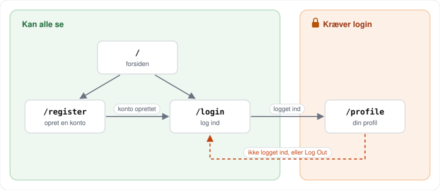
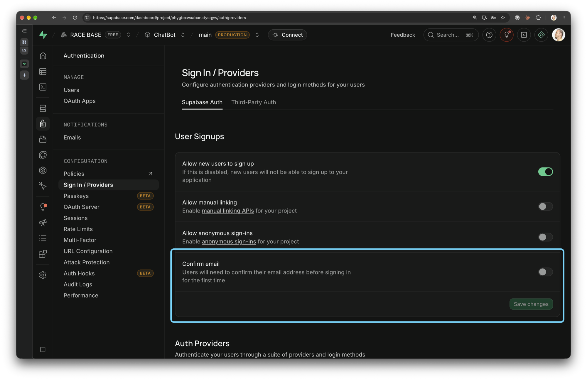
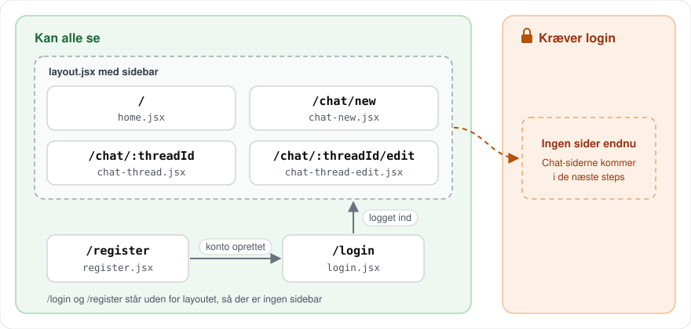
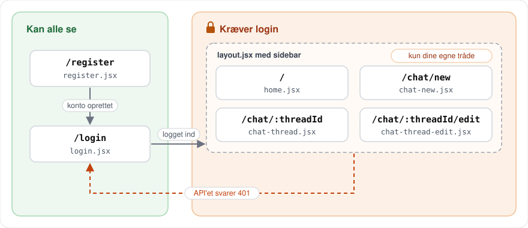

# React Supabase Auth: Login før chatbotten

## Kort fortalt

Du bygger en lille React-app, hvor man kan oprette en konto, logge ind og se sin egen profil. Appen bruger samme opsætning som chatbotten: React Router med `clientAction` og `clientLoader`, og Supabase Auth til brugere, passwords og tokens.

Når du er færdig, har du lavet det samme som i [step 14](https://github.com/bewildergeist/chatbot-react-postgres/pull/14) i chatbot-tutorialen, bare i et mindre projekt. Så kan du bagefter lave step 14 i chatbotten selv. Sidst i opgaven står, hvilken øvelse der svarer til hvilken delopgave i step 14.

Du bruger dit eksisterende Supabase-projekt fra chatbotten. De brugere, du opretter her, kan du også logge ind med i chatbotten.

Løsningen ligger i [react-supabase-auth](https://github.com/cederdorff/react-supabase-auth) med én branch pr. øvelse. Branchen viser koden, når hele øvelsen er løst.

<details>
<summary>💡 Sidder du fast undervejs? Sådan bruger du hjælpen i denne øvelse</summary>

Prøv selv først. Går det ikke:

1. Åbn **Hint**-toggle'n under øvelsen. Den peger dig i den rigtige retning uden at give dig koden.
2. Åbn **Løsningsforslag**-toggle'n, når hintet ikke er nok, eller når du vil sammenligne med din egen kode.

Spring aldrig en test over, heller ikke når den virker oplagt.

</details>

## Det bygger du



Det sker i koden, når du bruger siderne:

```text
/register  -> clientAction -> signUp()             -> redirect("/login?registered=true")
/login     -> clientAction -> signInWithPassword() -> token i localStorage -> redirect("/profile")
/profile   -> clientLoader -> getUser()            -> vis brugeren, eller redirect("/login")
Log Out    -> clientAction -> signOut()            -> token slettet -> redirect("/login")
```

---

## Øvelse 1: Hent startprojektet

1. Opret en ny, tom mappe, `react-supabase-auth`, der hvor du har dine kodeprojekter. Åbn den i VS Code med File → Open Folder. I Explorer kan du se mappens navn, men ingen filer.
2. Klik Initialize Repository under Source Control. Mappen er nu roden af dit repo.
3. Åbn terminalen i VS Code med Terminal → New Terminal. På Windows skal du vælge Command Prompt, fordi PowerShell ofte blokerer npm. Terminalen står i roden af repoet. Tjek, at der står `react-supabase-auth` i prompten.
4. Hent startprojektet med denne kommando i terminalen:

   ```bash
   npx degit --force cederdorff/react-supabase-auth
   ```

   Filerne lander direkte i roden af repoet, ikke i en undermappe. `--force` skal med, fordi Initialize Repository har lavet en skjult `.git`-mappe. Uden `--force` stopper degit, fordi mappen ikke er tom.

5. Commit startprojektet, før du ændrer noget. Klik Publish Branch for at lægge det på GitHub. Fra nu af committer og pusher du efter hver øvelse.
6. Installér og start projektet i samme terminal:

   ```bash
   npm install
   npm run dev
   ```

Kig projektet igennem:

- `react-router.config.js`: `ssr: false` betyder, at appen kører i browseren, ligesom chatbotten
- `app/routes.js`: indtil videre findes kun forsiden
- `app/routes/register.jsx` og `app/routes/login.jsx`: formularerne er færdige, men de gør ikke noget endnu
- `app/app.css`: al styling er klar. Du behøver ikke røre filen

#### Test øvelse 1

Åbn den URL, terminalen viser ved `Local`. Klik på "Create Account". Du får en 404. Det retter du i øvelse 3.

---

## Øvelse 2: Supabase-klienten

> **Supabase Auth:** Indtil nu har du brugt Supabase som database. Supabase Auth er den del af Supabase, der klarer brugere. Den gemmer passwords sikkert, udsteder tokens og kan sende bekræftelsesmails. Brugerne ligger i tabellen `auth.users`, adskilt fra dine egne tabeller.

**1. Installér** Supabase' JavaScript-klient. Stop først `npm run dev` med Ctrl+C:

```bash
npm install @supabase/supabase-js
```

**2. Lav `.env`.** Kopiér `.env.example` til en ny fil, `.env`. Indsæt URL og key fra chatbottens `frontend/.env`. Du kan også finde dem i Supabase under Project Settings → API Keys. Står der en "publishable key" (`sb_publishable_...`), så brug den. Den virker på samme måde som en anon key.

> **`VITE_` og nøgler:** Vite giver din kode adgang til `.env` med `import.meta.env`, men kun til variabler, der starter med `VITE_`. Alt med `VITE_` ender i browseren, hvor alle kan læse det. Anon key og publishable key må gerne ligge der, fordi Supabase selv tjekker, hvad de må. Service role key og secret key giver adgang til alt og må aldrig stå i en `VITE_`-variabel.

**3. Slå "Confirm email" fra** i Supabase. Gå til Authentication → Sign In / Providers, slå Confirm email fra under User Signups, og klik Save changes. Ellers skal hver ny bruger bekræfte sin email, og Supabase sender kun få mails i timen.



**4. Opret** `app/lib/supabase.js`:

```js
import { createClient } from "@supabase/supabase-js";

const supabaseUrl = import.meta.env.VITE_SUPABASE_URL;
const supabaseAnonKey = import.meta.env.VITE_SUPABASE_ANON_KEY;

// TODO: Hvis en af de to mangler, så kast en Error med en tydelig besked.

// TODO: Lav klienten med createClient(supabaseUrl, supabaseAnonKey), og eksportér den som supabase.
```

<details>
<summary>Hint</summary>

```text
if (!supabaseUrl || !supabaseAnonKey) {
  throw new Error("...")
}

export const supabase = createClient(...)
```

</details>

<details>
<summary>Se løsningsforslag</summary>

```js
import { createClient } from "@supabase/supabase-js";

// Kun variabler, der starter med VITE_, kommer med ud i browseren
const supabaseUrl = import.meta.env.VITE_SUPABASE_URL;
const supabaseAnonKey = import.meta.env.VITE_SUPABASE_ANON_KEY;

if (!supabaseUrl || !supabaseAnonKey) {
  throw new Error(
    "Missing VITE_SUPABASE_URL or VITE_SUPABASE_ANON_KEY. Copy .env.example to .env and fill in the values.",
  );
}

// Én fælles klient, som resten af appen importerer
export const supabase = createClient(supabaseUrl, supabaseAnonKey);
```

</details>

#### Test øvelse 2

1. Start `npm run dev` igen. Vite læser kun `.env`, når serveren starter.
2. Tilføj midlertidigt `import { supabase } from "../lib/supabase";` og `console.log(supabase);` øverst i `app/routes/home.jsx`. Du skal se et objekt i Console.
3. Slet linjen med `VITE_SUPABASE_URL` i `.env`, og genstart. Læs fejlen. Sæt linjen ind igen.
4. Fjern import og `console.log` fra `home.jsx` igen.

---

## Øvelse 3: Routes til login og register

**Prøv det først:** gå til `/register`. Du får en 404, fordi React Router ikke kender siden.

Tilføj `register` og `login` i `app/routes.js`. `route` er allerede importeret.

<details>
<summary>Se løsningsforslag</summary>

```js
import { index, route } from "@react-router/dev/routes";

export default [
  index("routes/home.jsx"),
  route("register", "routes/register.jsx"),
  route("login", "routes/login.jsx"),
];
```

</details>

#### Test øvelse 3

Gå til `/register` og `/login`. Begge sider skal vises, og linkene nederst skal skifte mellem dem.

---

## Øvelse 4: Opret en bruger

**Prøv det først:** udfyld formularen på `/register`, og tryk "Create Account". Læs fejlen. Formularen sender til routen, men routen har ingen `clientAction`, der kan tage imod.

Du bygger `clientAction` i tre trin og tester efter hvert trin.

### Trin 1: Læs formularen

Tilføj en `clientAction` øverst i `app/routes/register.jsx`. Hent `email` og `password` fra formularen, og log dem med `console.log`. Du har gjort det samme i chatbotten, fx da du sendte en besked.

```js
export async function clientAction({ request }) {
  // TODO: Hent formData fra request.
  // TODO: Hent email og password fra formData.
  // TODO: Log email og password.
}
```

<details>
<summary>Hint</summary>

`formData.get()` skal have inputtets `name`. Kig på de to inputs i formularen.

```text
const formData = await request.formData()
const email = formData.get(...)
```

</details>

<details>
<summary>Se løsningsforslag</summary>

```js
export async function clientAction({ request }) {
  const formData = await request.formData();
  const email = formData.get("email");
  const password = formData.get("password");

  console.log(email, password);
}
```

</details>

#### Test trin 1

1. Åbn Console i DevTools. Udfyld formularen, og tryk "Create Account". Står din email og dit password i Console?
2. Kig i terminalen, hvor `npm run dev` kører. Der står de ikke. `clientAction` kører i browseren.
3. Ret `"email"` til `"mail"` i `formData.get()`, og send igen. Hvad bliver logget? Ret det tilbage.

### Trin 2: Opret brugeren

Importér `supabase` fra `../lib/supabase`. Opret brugeren med `supabase.auth.signUp({ email, password })`, og log hele svaret.

```js
// TODO: Opret brugeren med supabase.auth.signUp({ email, password }), og gem svaret i en variabel.
// TODO: Log svaret.
```

<details>
<summary>Se løsningsforslag</summary>

```js
import { Form, Link } from "react-router";
import { supabase } from "../lib/supabase";

export async function clientAction({ request }) {
  const formData = await request.formData();
  const email = formData.get("email");
  const password = formData.get("password");

  // Supabase hasher passwordet med bcrypt og gemmer brugeren i auth.users
  const result = await supabase.auth.signUp({ email, password });
  console.log(result);
}
```

</details>

#### Test trin 2

1. Opret en bruger. Fold svaret ud i Console. Det er et objekt med `data` og `error`. Står din email i `data.user`? Hvad står der i `error`?
2. Find brugeren i Supabase under Authentication → Users.
3. Opret den samme email igen. Hvad står der nu i `data.user` og i `error`?

### Trin 3: Håndtér fejl, og send videre

Du skal kun bruge `error` fra svaret.

- Hvis der er en `error`, så log den med `console.error`, og returnér `null`
- Ellers: `redirect("/login?registered=true")`
- Fjern dine `console.log`

<details>
<summary>Hint</summary>

Hent `error` direkte ud af svaret, og husk at importere `redirect` fra `react-router`:

```text
const { error } = await supabase.auth.signUp(...)
```

</details>

<details>
<summary>Se løsningsforslag</summary>

```js
import { Form, Link, redirect } from "react-router";
import { supabase } from "../lib/supabase";

export async function clientAction({ request }) {
  const formData = await request.formData();
  const email = formData.get("email");
  const password = formData.get("password");

  // Supabase hasher passwordet med bcrypt og gemmer brugeren i auth.users
  const { error } = await supabase.auth.signUp({ email, password });

  if (error) {
    console.error("Registration error:", error);
    return null;
  }

  return redirect("/login?registered=true");
}
```

</details>

#### Test trin 3

1. Åbn Network-fanen i DevTools, og opret en ny bruger. Du skal ende på `/login`.
2. Find requestet til `.../auth/v1/signup` i Network-fanen. Kig i Payload. Står passwordet i klartekst? Står der `https` i URL'en?
3. Åbn Table Editor, vælg schema `auth` og tabellen `users`. Find kolonnen `encrypted_password`. Hashen starter med `$2a$`, som betyder bcrypt. Det er samme slags hash, som `crypt(..., gen_salt('bf'))` gav dig i SQL Editor.
4. Opret en bruger mere med samme password. Er de to hashes ens?
5. Opret en email, der allerede findes. Du skal blive på `/register` og se fejlen i Console.

> **Salt:** Passwordet står i klartekst i requestet, men forbindelsen er HTTPS, så det er krypteret på vejen. Først hos Supabase bliver det hashet med bcrypt. Hver bruger får sin egen tilfældige salt, som bliver blandet ind i hashen. Derfor giver to ens passwords to forskellige hashes.

---

## Øvelse 5: Validering

**Prøv det først:** opret en ny bruger, hvor de to passwords er forskellige. Brugeren bliver oprettet alligevel, fordi din `clientAction` aldrig kigger på `confirmPassword`.

Du bygger valideringen i tre trin og tester efter hvert trin.

### Trin 1: Vis én fejl

**I `clientAction`:** Hent også `confirmPassword` fra `formData`. Returnér `{ error: "Passwords do not match" }`, hvis de to passwords er forskellige. Tjekket skal stå før `signUp()`, så brugeren ikke bliver oprettet.

**I componenten:** Hent det, `clientAction` returnerede, med `useActionData()`. Vis fejlen lige over knappen:

```jsx
{actionData?.error && <div className="error-message">{actionData.error}</div>}
```

> **`useActionData()`:** Når `clientAction` returnerer et objekt i stedet for en `redirect`, bliver du på siden. `useActionData()` giver componenten det objekt, så du kan vise fejlen. Før formularen er sendt, er `actionData` `undefined`. Derfor står der `?.`.

<details>
<summary>Hint</summary>

```text
const actionData = useActionData()
```

Husk at importere `useActionData` fra `react-router`.

</details>

<details>
<summary>Se løsningsforslag</summary>

```jsx
import { Form, Link, redirect, useActionData } from "react-router";
import { supabase } from "../lib/supabase";

export async function clientAction({ request }) {
  const formData = await request.formData();
  const email = formData.get("email");
  const password = formData.get("password");
  const confirmPassword = formData.get("confirmPassword");

  if (password !== confirmPassword) {
    return { error: "Passwords do not match" };
  }

  // ... signUp() og redirect som før
}

export default function Register() {
  const actionData = useActionData();

  return (
    // ... formularen som før, og lige over knappen:
    <>
      {actionData?.error && (
        <div className="error-message">{actionData.error}</div>
      )}
    </>
  );
}
```

</details>

#### Test trin 1

1. Opret en bruger med to forskellige passwords. Du skal se "Passwords do not match" over knappen.
2. Tjek under Authentication → Users, at brugeren ikke blev oprettet.
3. Fjern `?` fra `actionData?.error`, og genindlæs `/register`. Læs fejlen. Sæt `?` ind igen.

### Trin 2: Flere regler

Tilføj flere tjek i `clientAction`, før `signUp()`. Tjek for tomme felter først.

- Returnér `{ error: "..." }`, hvis et felt er tomt
- Returnér `{ error: "..." }`, hvis passwordet er under 6 tegn
- Returnér `{ error: error.message }` i stedet for `null`, når Supabase giver en fejl. Så kan du fjerne `console.error`

<details>
<summary>Se løsningsforslag</summary>

```js
export async function clientAction({ request }) {
  const formData = await request.formData();
  const email = formData.get("email");
  const password = formData.get("password");
  const confirmPassword = formData.get("confirmPassword");

  if (!email || !password || !confirmPassword) {
    return { error: "All fields are required" };
  }

  if (password !== confirmPassword) {
    return { error: "Passwords do not match" };
  }

  if (password.length < 6) {
    return { error: "Password must be at least 6 characters" };
  }

  // Supabase hasher passwordet med bcrypt og gemmer brugeren i auth.users
  const { error } = await supabase.auth.signUp({ email, password });

  if (error) {
    return { error: error.message };
  }

  return redirect("/login?registered=true");
}
```

</details>

#### Test trin 2

Opret en email, der allerede findes. Nu står Supabase' fejlbesked i formularen og ikke i Console.

Der er tre lag validering. Test dem et ad gangen:

1. **HTML:** prøv at sende en tom formular. Browseren stopper dig, fordi felterne har `required`.
2. **Din `clientAction`:** fjern `required` og `minLength` fra de tre inputs. Send en tom formular, to forskellige passwords og et password på 3 tegn. Du skal se dine egne fejlbeskeder.
3. **Supabase:** udkommentér dit tjek af længden, og send et password på 3 tegn. Nu svarer Supabase selv med en fejl.

De to første lag kan enhver komme uden om, ligesom du lige gjorde. Det sidste lag ligger på serveren. Sæt `required`, `minLength` og dit længdetjek ind igen.

### Trin 3: Slå knappen fra, mens formularen sendes

Brug `useNavigation()` til at slå knappen fra og skrive "Creating account...", mens formularen sendes.

> **`useNavigation()`:** fortæller, hvad routen er i gang med. Mens formularen bliver sendt, er `navigation.state` lig med `"submitting"`. Så kan du slå knappen fra, så ingen trykker to gange.

<details>
<summary>Hint</summary>

```text
const navigation = useNavigation()
const isSubmitting = navigation.state === "submitting"
```

Husk at importere `useNavigation` fra `react-router`.

</details>

<details>
<summary>Se løsningsforslag</summary>

```jsx
import {
  Form,
  Link,
  redirect,
  useActionData,
  useNavigation,
} from "react-router";

export default function Register() {
  const actionData = useActionData();
  const navigation = useNavigation();
  const isSubmitting = navigation.state === "submitting";

  return (
    // ... formularen som før, men knappen bliver til:
    <button type="submit" disabled={isSubmitting} className="btn-primary">
      {isSubmitting ? "Creating account..." : "Create Account"}
    </button>
  );
}
```

</details>

#### Test trin 3

1. Opret en bruger. Det går så hurtigt, at du ikke kan nå at se teksten på knappen.
2. Åbn Network-fanen. Vælg "Slow 4G" i menuen, hvor der står "No throttling". Opret en ny bruger. Nu skal knappen være falmet og vise "Creating account...".
3. Sæt menuen tilbage til "No throttling".

---

## Øvelse 6: Log ind

> **Hvad sker der ved login?** Browseren sender email og password til Supabase over HTTPS. Salten står i selve hashen i `auth.users`. Supabase hasher det indtastede password med samme salt og sammenligner med hashen. Passer de, svarer Supabase med et access token og et refresh token. Supabase-klienten gemmer dem i localStorage. Dem kigger du på i øvelse 7.

Gør det samme for `app/routes/login.jsx`:

- En `clientAction`, der henter `email` og `password` og returnerer `{ error: "..." }`, hvis et af dem mangler
- Log ind med `supabase.auth.signInWithPassword({ email, password })`
- Ved fejl: returnér `{ error: "Invalid email or password" }`
- Ellers: `redirect("/")`
- Vis fejlen med `useActionData()`, og skriv "Logging in..." på knappen med `useNavigation()`

Vis til sidst en velkomstbesked lige over `<Form>`, når man kommer fra `/register`. Din `clientAction` i `register.jsx` sender til `/login?registered=true`. Læs `registered` fra URL'en med `useSearchParams()`, og gem resultatet i `justRegistered`:

```jsx
{justRegistered && (
  <div className="success-message">Account created successfully! Please log in.</div>
)}
```

<details>
<summary>Hint</summary>

`useSearchParams()` returnerer et array ligesom `useState()`. Du skal kun bruge den første værdi:

```text
const [searchParams] = useSearchParams()
const justRegistered = searchParams.get("registered") === "true"
```

</details>

<details>
<summary>Se løsningsforslag</summary>

```jsx
import {
  Form,
  Link,
  redirect,
  useActionData,
  useNavigation,
  useSearchParams,
} from "react-router";
import { supabase } from "../lib/supabase";

export async function clientAction({ request }) {
  const formData = await request.formData();
  const email = formData.get("email");
  const password = formData.get("password");

  if (!email || !password) {
    return { error: "Email and password are required" };
  }

  // Supabase sammenligner passwordet med hashen og gemmer et JWT i localStorage
  const { error } = await supabase.auth.signInWithPassword({ email, password });

  if (error) {
    return { error: "Invalid email or password" };
  }

  return redirect("/");
}

export default function Login() {
  const actionData = useActionData();
  const navigation = useNavigation();
  const isSubmitting = navigation.state === "submitting";

  const [searchParams] = useSearchParams();
  const justRegistered = searchParams.get("registered") === "true";

  // ... resten af componenten med justRegistered, actionData og isSubmitting
}
```

</details>

#### Test øvelse 6

1. Opret en ny bruger. Står velkomstbeskeden på `/login`?
2. Log ind med forkert password. Du skal se din fejlbesked.
3. Log ind med det rigtige password. Du skal ende på forsiden.
4. Fejlbeskeden siger ikke, om det er emailen eller passwordet, der er forkert. Hvorfor er det en god idé?

---

## Øvelse 7: Kig i dit JWT

Her skal du ikke skrive kode.

1. Log ind, og åbn DevTools → Application → Local Storage → `http://localhost:5173`.
2. Find nøglen, der starter med `sb-` og slutter med `-auth-token`. Værdien er et JSON-objekt.
3. Kopiér værdien af `access_token`, og indsæt den på [jwt.io](https://jwt.io).
4. Et JWT har tre dele adskilt af punktummer: header, payload og signatur. Find i payloaden:
   - `sub`: dit bruger-id. Sammenlign det med id'et i Supabase under Authentication → Users
   - `email`
   - `role`
   - `iat` og `exp`: hvornår tokenet er lavet, og hvornår det udløber. Skriv `new Date(exp * 1000)` i Console med tallet fra `exp`

Svar på:

- Hvor længe lever tokenet?
- Står dit password nogen steder i tokenet?
- jwt.io kunne læse payloaden uden nogen nøgle. Hvad betyder det for, hvad man må gemme i et JWT?
- Hvad tror du `refresh_token` bruges til?

> **Signatur:** Et JWT er kun kodet, ikke krypteret. Derfor kunne jwt.io læse det uden nogen nøgle. Den sidste del, signaturen, har Supabase lavet med en hemmelig nøgle, som ligger i dit Supabase-projekt og aldrig i browseren. Ændrer nogen ét tegn i tokenet, passer signaturen ikke længere til indholdet. Alle kan altså læse et JWT, men ingen kan rette i det, uden at Supabase opdager det.

---

## Øvelse 8: Profilside

**Prøv det først:** gå til `/profile`. Du får en 404.

Du bygger siden i to trin.

### Trin 1: Kig på svaret fra `getUser()`

Tilføj `profile` i `app/routes.js`. Opret `app/routes/profile.jsx` med en `clientLoader`, der henter brugeren og logger svaret:

```jsx
import { supabase } from "../lib/supabase";

export async function clientLoader() {
  // TODO: Hent brugeren med supabase.auth.getUser(), og gem svaret i en variabel.
  // TODO: Log svaret.
}

export default function Profile() {
  return <h1>My Profile</h1>;
}
```

<details>
<summary>Se løsningsforslag</summary>

```js
export async function clientLoader() {
  const result = await supabase.auth.getUser();
  console.log(result);
}
```

</details>

#### Test trin 1

1. Log ind, og gå til `/profile`. Fold svaret ud i Console. Det har samme form som svaret fra `signUp()`. Står din email i `data.user`? Hvad står der i `error`?
2. Åbn `/profile` i et inkognitovindue, hvor du ikke er logget ind. Hvad står der nu i `data.user` og i `error`?

### Trin 2: Redirect, og vis brugeren

- Hvis der er en `error`, eller `data.user` mangler: `redirect("/login")`
- Ellers: returnér `{ user: data.user }`
- Fjern din `console.log`
- Ret `redirect("/")` i `login.jsx` til `redirect("/profile")`

Tilføj importen øverst, og erstat componenten med denne. Den viser brugeren med `useLoaderData()`:

```jsx
import { Link, redirect, useLoaderData } from "react-router";

export default function Profile() {
  const { user } = useLoaderData();

  return (
    <div className="auth-container">
      <div className="auth-card">
        <h1>My Profile</h1>
        <p className="auth-subtitle">You are logged in</p>

        <dl className="profile-list">
          <dt>Email</dt>
          <dd>{user.email}</dd>
          <dt>User ID</dt>
          <dd>{user.id}</dd>
          <dt>Last sign in</dt>
          <dd>{new Date(user.last_sign_in_at).toLocaleString()}</dd>
        </dl>

        <p className="auth-footer">
          <Link to="/">Back to start</Link>
        </p>
      </div>
    </div>
  );
}
```

<details>
<summary>Hint</summary>

```text
const { data, error } = await supabase.auth.getUser()

if (error || !data.user) {
  return redirect(...)
}
```

</details>

<details>
<summary>Se løsningsforslag</summary>

```js
export async function clientLoader() {
  // getUser() sender tokenet til Supabase, som tjekker signaturen
  const { data, error } = await supabase.auth.getUser();

  if (error || !data.user) {
    return redirect("/login");
  }

  return { user: data.user };
}
```

</details>

#### Test trin 2

1. Log ind. Du skal ende på `/profile` og se din email og dit id.
2. Gå til `/profile` i inkognitovinduet. Du skal blive sendt til `/login`.
3. Åbn Local Storage i dit almindelige vindue igen. Dobbeltklik på værdien, og ret ét bogstav midt i `access_token`. Ikke det sidste, for det tæller ikke altid med. Genindlæs `/profile`. Hvad sker der?
4. Log ind igen for at få et gyldigt token.

Tokenets vej fra login til `/profile`:

```text
Log ind:       email + password -> Supabase tjekker hashen      -> access_token gemmes i localStorage
/profile:      access_token     -> Supabase tjekker signaturen  -> { user }
Rettet token:  access_token     -> signaturen passer ikke       -> error -> redirect("/login")
```

> `getUser()` sender tokenet til Supabase, som tjekker signaturen. Passer den ikke til indholdet, afviser Supabase tokenet, og din `clientLoader` sender dig til `/login`. Derfor kan man ikke bare ændre sit bruger-id i tokenet.

---

## Øvelse 9: Log ud (bonus)

Tilføj en `clientAction` i `profile.jsx`, der logger ud med `supabase.auth.signOut()` og sender videre til `/login`. Tilføj en knap i en `<Form method="post">` lige under `</dl>`:

```jsx
<Form method="post">
  <button type="submit" className="btn-secondary">
    Log Out
  </button>
</Form>
```

<details>
<summary>Se løsningsforslag</summary>

```jsx
import { Form, Link, redirect, useLoaderData } from "react-router";

export async function clientAction() {
  // Fjerner tokenet fra localStorage
  await supabase.auth.signOut();
  return redirect("/login");
}
```

</details>

#### Test øvelse 9

1. Log ud. Er nøglen `sb-...-auth-token` væk fra Local Storage?
2. Gå til `/profile`. Du skal blive sendt til `/login`.

---

## Fra øvelserne til step 14

Nu laver du det samme i chatbotten. Er du ikke færdig med step 13, så hent startpunktet i roden af chatbot-repoet, og commit det, før du ændrer noget:

```bash
npx degit --force bewildergeist/chatbot-react-postgres#pr-14-start
```

Startpunktet følger tutorialen og opretter tråde uden `user_id`. I kursets database skal en tråd have en ejer, så du får en fejl, når du opretter en ny tråd. Sæt `TEST_USER_ID` ind i `backend/server.js` igen, som i trin 12:

```js
// alice fra seed.sql, indtil vi har login
const TEST_USER_ID = "00000001-0001-0001-0001-000000000001";

// i POST /api/threads
INSERT INTO threads (title, user_id)
VALUES (${trimmedTitle}, ${TEST_USER_ID})
```

| Step 14 | Det har du lavet i |
| --- | --- |
| Delopgave 1: Install Supabase client library | Øvelse 2. Installér inde i `frontend/`, hvor `package.json` ligger |
| Delopgave 2: Create Supabase client module | Øvelse 2 |
| Delopgave 3: Configure environment variables | Øvelse 2. `.env` findes allerede i `frontend/` |
| Delopgave 4: Build the registration page | Øvelse 4 og 5. Lad dig inspirere af din `register.jsx` |
| Delopgave 5: Build the login page | Øvelse 6 og 7. Lad dig inspirere af din `login.jsx`. Tutorialen sender til `/` i stedet for `/profile` |
| Delopgave 6: Style the authentication pages | Kopiér afsnittet `Authentication Pages` fra `app.css` i dette projekt. Klasserne har samme navne |
| Delopgave 7: Register authentication routes | Øvelse 3. Her skal routes stå uden for layoutet, så sidebaren ikke vises. Lav den før delopgave 4, så du kan se siderne, mens du bygger dem |

Efter step 14 ser chatbottens sider sådan ud. Sammenlign med billedet under [Det bygger du](#det-bygger-du):



Efter step 14 kræver ingen af siderne login. Chat-siderne kommer over i "Kræver login" i de næste steps. Se [Hvor ender chatbotten?](#hvor-ender-chatbotten)

Step 14 siger, at du bliver logget ud, hvis du retter ét tegn i tokenet. I chatbotten sker der ikke noget endnu, fordi intet kalder `getUser()`. Du så det på `/profile` i øvelse 8.

Profilsiden og logout er ikke med i step 14. Logout kommer i step 15.

---

## Hvor ender chatbotten?

Efter step 18 ser chatbotten sådan ud:



Step 15 sender tokenet med til backenden. Step 16 får backenden til at kræve det. Backenden tjekker tokenet med den samme `getUser()`, som du brugte på `/profile`. Step 17 sørger for, at du kun ser dine egne tråde, og step 18 sender dig til `/login`, når API'et svarer 401. Så virker testen fra øvelse 8 også i chatbotten: ret ét tegn i tokenet, og du bliver sendt til `/login`.
